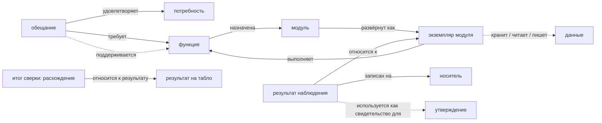

# Правило связывания цифровых двойников

> **Как читать.** Правило задаёт, из каких записей собирается двойник любого предмета экосистемы и как эти записи связаны. Оно одно на все пять двойников. Описания самих двойников ведутся рядом, в паке экосистемы; применение к платформе и IWE — в паке платформы (DP.ARCH.001 §11, §18). Реализации, программ сбора, конкретных идентификаторов и чисел текущего года здесь нет.

## 1. Назначение

По двойнику проверяющий видит расхождение между задуманным, развёрнутым и наблюдаемым у конкретного обещания и результата. Приёмка архитектурных описаний идёт по своим критериям и использует эту сверку как один из источников; сама сверка приёмкой не является. Цель разработки задают потребности и обещания (документ 2 и документ 4 «Состояние по потребностям»); результаты и их стадии ведёт табло результатов. Двойник их не заменяет.

## 2. Что такое двойник в этом правиле

Слово «цифровой двойник» многозначно: им называют модель, программу, датчики, телеметрию, метод моделирования и работу по обновлению. Здесь оно закреплено локально, другие значения не отменяются:
- **цифровой двойник предмета** — подборка описаний одного названного предмета: утверждения трёх слоёв (§4) и результаты наблюдений за ним, собранные для названного применения — сверки задуманного с фактическим;
- программы, которые эти описания хранят, собирают и показывают, — системы; таблицы и файлы с записями — документы. Ни те ни другие двойником не являются;
- хранилище состояния человека на платформе (DP.ARCH.003; в DP.ARCH.001 §9.1 оно названо «цифровой двойник») различается на три предмета: программы расчёта и чтения — системы; таблица, в которой лежат показатели, — документ; сами показатели — описание человека. Показатели — одно из описаний, из которых собран двойник человека; программы и таблица двойником не являются. Соответствие значений: в паке платформы слово «двойник» обозначает это хранилище, в этом правиле — всю подборку описаний.

## 3. Пять предметов

| Предмет | Связанные РП | Кто ведёт первичные реестры |
|---|---|---|
| Человек | РП-151 | требует решения пилота |
| Установка IWE | РП-616 | требует решения пилота |
| Платформа | РП-507 (наблюдаемое платформы и IWE) | агент (решение пилота 17.11) |
| Aisystant | не определены | требует решения пилота |
| МИМ | не определены | требует решения пилота |

Для Aisystant и МИМ до описания двойника нужно определить границу экземпляра, практический вопрос, владельцев первичных реестров и РП, который ведёт описание двойника (запись Ф32, 14.11). Отдельный координирующий РП не вводится: координация идёт в фазе Ф32 РП-611. Списки ролей и обещаний организаций сами по себе двойником не считаются (запись Ф32, 14.11). Платёжный путь «платёж → подписка → доступ» (РП-542, РП-246) — сквозной случай проверки, не отдельный двойник.

## 4. Виды записей

**Объект.** Постоянный локальный идентификатор; род по реестру родов; реестр-первоисточник идентичности. Решает, тот же ли это объект, роль, которая ведёт этот реестр.

Если запись в ожидаемом реестре-первоисточнике не найдена, в записи случая создаётся временная ссылка вида `local:` на наблюдаемый объект. Она не является идентификатором объекта в первичном реестре и не устанавливает тождество. Указываются ожидаемый реестр, его владелец, основание поиска и конкретный срок пересмотра. Владелец реестра создаёт недостающую запись после получения замечания о неполной цепочке. После появления записи фиксируются её адрес, основание сопоставления и событие прекращения временной ссылки. До этого путь по объекту неполон; отсутствие записи не доказывает отсутствие объекта.

**Утверждение.** Об объекте или о связи двух объектов; слой (задуманное / развёрнутое / наблюдаемое) — свойство утверждения, не объекта; сила (цель, предсказание или условие применимости); значение; адрес записи-источника (код реестра, идентификатор записи, редакция или дата извлечения); дата фиксации; срок действия (любая граница может быть открытой). Каждая связь из словаря (§5) записывается как утверждение, поэтому у каждого звена есть источник и дата.

У связи есть статус подтверждения: «подтверждена» или «кандидат». Если обещание касается описания, а не работы модуля, связь «требует» с функцией можно записать как кандидата для разбора. Автор кандидата не подтверждает собственную связь: если он совпадает с владельцем описания, по умолчанию подтверждение даёт второй агент; пилота зовут при споре. Пилот разрешает спор о применении правила, но не подменяет запись первоисточника. Владелец вносит подтверждённую связь в свой реестр с датой, основанием и тем, кто подтвердил; решение независимого подтверждающего сохраняется вместе со ссылкой на реестровую запись. Кандидат не засчитывается в полный путь приёмки.

**Результат наблюдения.** Описание, полученное работой наблюдения (чтение журнала, съём телеметрии, испытание); объект, к которому относится; время; ссылка на утверждение слоя «развёрнутое», описывающее конфигурацию, при которой наблюдали; адрес носителя. Работа наблюдения, её результат и носитель — разные предметы; наличие носителя само по себе ничего не доказывает.

**Итог сверки.** Сравнение конкретной формулировки утверждения задуманного или развёрнутого слоя с результатом наблюдения об одном установленном объекте. Запись содержит ссылки на сравниваемые формулировки, критерий, окно, метод и владельца наблюдения, обещание и, при расхождении, идентификатор результата на табло. До согласования формата с РП-529 записывается свободная ссылка с пометкой «формат по РП-529». Исходы: «соответствует», «расхождение», «нет данных», «несравнимо».

- «Соответствует» — наблюдение относится к тому же экземпляру, попадает в окно и совпадает с формулировкой по исходу и последствию.
- «Расхождение» — условия сопоставимы, но исход или последствие другие. Если условие предсказания наступило при подтверждённом покрытии, а предсказанный исход не наступил, это расхождение.
- «Нет данных» — по записанному методу источник существует и известно начало его ведения, но нужный период не покрыт, включая время до начала журнала. Это не событие, подтверждение или опровержение.
- «Несравнимо» — формулировку нельзя сопоставить: условие предсказания не наступило, нет журнала или версии конфигурации, нет нужного признака либо условия отличаются.

Сначала проверяется полнота цепочки объектов и связей. Если она неполна, итог не выставляется: случай остаётся в состоянии «сверка не завершена» с указанием недостающего звена; это не пятый исход. Несоответствие описания в таком случае записывается как замечание, не как итог «расхождение». Отсутствие журнала или данных не делает цепочку объектов и связей неполной, а получает исход по правилам выше. Затем по записанным методу и владельцу наблюдения проверяется покрытие источником, после чего выставляется исход. Реакция на расхождение — отдельное решение, правило её не задаёт.

Исход относится к конкретному сравнению; сила свидетельства — отдельное поле вывода о формулировке предсказания, которое не заменяет обязательные полярность, область и окно отношения «свидетельство» (§4). Одно независимое событие — «ограничивает»; два и более независимых события с одинаковым исходом в окне — «подтверждают» или «опровергают» эту формулировку (И-54). Ноль событий не создаёт свидетельства. При смешанных исходах каждое событие записывается со своим исходом и силой «ограничивает»; такой набор не «подтверждает» и не «опровергает». Независимость означает отдельные происшествия, наблюдённые раздельно по времени или источнику; разные записи одного происшествия независимыми не являются. Проявления одной причины могут быть независимыми, если это разные происшествия с раздельными наблюдениями. Владелец наблюдения записывает основание независимости; если она не установлена, события считаются одним. Критерий конкретного предсказания до начала окна может требовать более сильного свидетельства для приёмки, но не может ослаблять правило И-54 о числе событий.

**Карта идентификаторов.** Только тождество одного объекта: два реестра, два идентификатора, критерий «тот же объект», основание, источник, срок действия. Исход может быть «не установлено»; неоднозначность сохраняется, а не разрешается молча. История соответствий живёт здесь, а не в поле объекта. Соответствие разных объектов (например, «тип пака ↔ таблица») картой идентификаторов не является.

**Свидетельство — не вид записи, а отношение.** Результат наблюдения или иное описание используется как свидетельство для конкретного утверждения. У этого отношения обязательны полярность (подтверждает / опровергает / ограничивает), область и окно времени; без любого из них свидетельство не засчитывается.

## 5. Словарь связей

Модуль в слое «задуманное» — описание вида программы, одно на все площадки; экземпляр модуля — запущенная программа на конкретной площадке, система. Связь «развёрнут как» соединяет описание вида с экземпляром и не означает «входит в». Функция — описание поведения, которое требуется ради обещания; выполняет её только система (экземпляр модуля). Связь функции с модулем — назначение, многие ко многим, не тождество. Связь «поддерживается» означает, что функция повышает надёжность или доступность результата обещания, но не является необходимым условием его создания; она не заменяет «требует» (решение пилота 21.11).

| Связь | Откуда | Куда |
|---|---|---|
| удовлетворяет | обещание | потребность |
| требует | обещание | функция |
| поддерживается | обещание | функция |
| назначена | функция | модуль |
| развёрнут как | модуль | экземпляр модуля |
| выполняет | экземпляр модуля | функция |
| относится к | результат наблюдения | экземпляр модуля |
| записан на | результат наблюдения | носитель |
| используется как свидетельство для (подтверждает / опровергает / ограничивает) | результат наблюдения или иное описание | утверждение |
| относится к результату | итог сверки (расхождение) | результат на табло результатов (имя и направление — по модели табло) |

Дополнительные связи с данными (по схемам DP.ARCH.004): хранит, читает, пишет — три отдельных отношения. В слое «задуманное» они утверждаются о модуле, в слое «развёрнутое» — об экземпляре; фактическое обращение к данным фиксирует результат наблюдения.

## 6. Правила записи

1. Предметная запись изменяется только в своём реестре-первоисточнике; двойник содержит устойчивую ссылку на эту запись, не её копию. Роль, которая ведёт реестр идентичности объекта, не становится автоматически владельцем утверждений и результатов наблюдений о нём.
2. Общий граф пересобирается из реестров и сам первоисточником не бывает.
3. Отдельное хранилище графа не заводится, пока первый случай (одна установка IWE, РП-616 Ф12) не отвечен вручную по существующим реестрам (запись Ф32, 14.11).
4. Для двойника человека обязательны основание обработки и область доступа; проверка безопасности данных идёт до реализации (запись Ф32, 14.11).

## 7. Как расхождение попадает на табло

Если итог сверки — расхождение, он связывается с обещанием и результатом на табло результатов. Исход «несравнимо» тоже записывается: это признак недостающей посылки, а не соответствие. Формат строки табло согласуется с ролью, которая ведёт табло (РП-529); правило задаёт только требование.

### 7.1. Стоимость и канал наблюдения

В каждой записи случая фиксируются начало и конец сверки, суммарное время работы агента, источники, попытки доступа, вмешательство пилота и причина задержки. Время ожидания доступа или ответа записывается отдельно и не входит во время работы агента. Порог — один час работы агента на случай (решение пилота 19.11); превышение — повод разобрать причину, не автоматическое основание для нового канала.

Общий канал телеметрии не создаётся (решение пилота 19.11). Он рассматривается заново, если после документированных попыток сверки местных журналов нужные события утрачены или их отметки времени не позволяют проверить записанное предсказание. На утрату событий сначала отвечают продлением хранения или выгрузкой журнала. Повтор того же типа неудачи во втором случае выносится пилоту. Число установок само по себе не условие. Нехватка доступа решается выдачей доступа, не каналом.

## 8. Приёмка правила

Независимый читатель по правилу и записи первого случая проходит путь «потребность → обещание → функция → модуль → развёрнутый экземпляр → наблюдение → свидетельство» (критерий Ф32, 14.11). На языке этого правила последние звенья читаются так: результат наблюдения относится к экземпляру и используется как свидетельство для названного утверждения. Путь идёт по графу, а не по одной цепочке: у каждого ребра воспроизводимы источник и дата. Первый случай — одна установка IWE, пять шагов: состав установки; предсказание по DP.ARCH.001 §18 как утверждение силы «предсказание»; проверка испытанием или событием отказа; итоги сверки слоёв; одно изменение и повтор.

«Повтор после изменения» и «проверка предсказания» — разные достижения. Изменение, сделанное другим РП, можно использовать для наблюдения до/после. Запись предсказания одновременно содержит окно, критерий и метод. Предсказание записывается через запрос на изменение; временем записи считается время его слияния. Оно должно предшествовать началу окна. Авторская и коммиттерская даты в git сами по себе независимым подтверждением не являются. Правка предсказания после начала окна создаёт новую запись и задним числом не засчитывается; окно новой записи начинается не раньше времени слияния её запроса. Без такой записи наблюдение не подтверждает и не опровергает предсказание и не заменяет его проверку.

Полная приёмка случая требует отдельно предъявить изменение и повторное наблюдение после него, а также заранее записанное предсказание эффекта с окном, критерием, методом и итогом сверки. Одно наблюдение может служить обоим результатам, если соблюдены оба набора условий.

## 9. Схемы

Вид связей рисуется Mermaid в тексте пака и производен от реестров. Данные — по схемам DP.ARCH.004 (метод DP.METHOD.040). ECO.MAP.BIND.001 — существующее отображение «тип пака ↔ таблица»; его совместимость с картой идентификаторов проверяется отдельно.

## 10. Сопровождение

Владелец правила — пилот. Пересмотр по событию: новое применение правила или изменение словаря связей. Изменения словаря записываются журналом в конце этой записи.

## Открытые вопросы

- Кто ведёт первичные реестры каждого из пяти предметов.
- Граница экземпляра, практический вопрос и РП описания для двойников Aisystant и МИМ.
- Имя и направление связи «относится к результату» — по модели табло РП-529.
- Критерий, окно и метод проверки предсказания первого случая.

## Чего в записи нет

Реализации хранилища и программ сбора, конкретных идентификаторов, чисел и продуктов текущего года.
