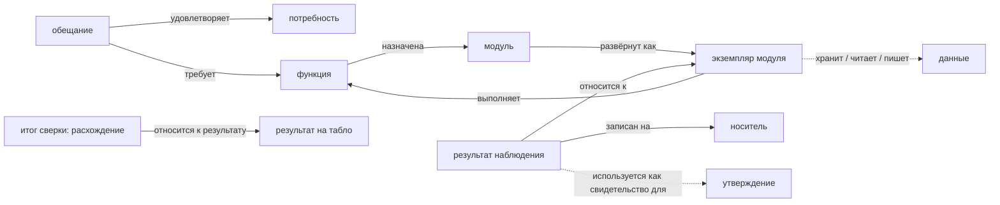

# Правило связывания цифровых двойников

> **Как читать.** Правило задаёт, из каких записей собирается двойник любого предмета экосистемы и как эти записи связаны. Оно одно на все пять двойников. Описания самих двойников ведутся рядом, в паке экосистемы; применение к платформе и IWE — в паке платформы (DP.ARCH.001 §11, §18). Реализации, программ сбора, конкретных идентификаторов и чисел текущего года здесь нет.

## 1. Назначение

По двойнику проверяющий видит расхождение между задуманным, развёрнутым и наблюдаемым у конкретного обещания и результата. Приёмка архитектурных описаний идёт по своим критериям и использует эту сверку как один из источников; сама сверка приёмкой не является. Цель разработки задают потребности и обещания (документ 2 и документ 4 «Состояние по потребностям»); результаты и их стадии ведёт табло результатов. Двойник их не заменяет.

## 2. Что такое двойник в этом правиле

Слово «цифровой двойник» многозначно: им называют модель, программу, датчики, телеметрию, метод моделирования и работу по обновлению. Здесь оно закреплено локально, другие значения не отменяются:
- **цифровой двойник предмета** — подборка описаний одного названного предмета: утверждения трёх слоёв (§4) и результаты наблюдений за ним, собранные для названного применения — сверки задуманного с фактическим;
- программы, которые эти описания хранят, собирают и показывают, — системы; таблицы и файлы с записями — документы. Ни те ни другие двойником не являются;
- хранилище состояния человека на платформе (DP.ARCH.003; в DP.ARCH.001 §9.1 оно названо «цифровой двойник») различается на три предмета: программы расчёта и чтения — системы; таблица, в которой лежат показатели, — документ; сами показатели — описание человека. Показатели — одно из описаний, из которых собран двойник человека; программы и таблица двойником не являются. Соответствие значений: в паке платформы слово «двойник» обозначает это хранилище, в этом правиле — всю подборку описаний.

## 3. Пять предметов

| Предмет | Связанные РП | Кто ведёт первичные реестры |
|---|---|---|
| Человек | РП-151 | требует решения пилота |
| Установка IWE | РП-616 | требует решения пилота |
| Платформа | РП-507 (наблюдаемое платформы и IWE) | требует решения пилота |
| Aisystant | не определены | требует решения пилота |
| МИМ | не определены | требует решения пилота |

Для Aisystant и МИМ до описания двойника нужно определить границу экземпляра, практический вопрос, владельцев первичных реестров и РП, который ведёт описание двойника (запись Ф32, 14.11). Отдельный координирующий РП не вводится: координация идёт в фазе Ф32 РП-611. Списки ролей и обещаний организаций сами по себе двойником не считаются (запись Ф32, 14.11). Платёжный путь «платёж → подписка → доступ» (РП-542, РП-246) — сквозной случай проверки, не отдельный двойник.

## 4. Виды записей

**Объект.** Постоянный локальный идентификатор; род по реестру родов; реестр-первоисточник идентичности. Решает, тот же ли это объект, роль, которая ведёт этот реестр.

**Утверждение.** Об объекте или о связи двух объектов; слой (задуманное / развёрнутое / наблюдаемое) — свойство утверждения, не объекта; сила (цель, предсказание или условие применимости); значение; адрес записи-источника (код реестра, идентификатор записи, редакция или дата извлечения); дата фиксации; срок действия (любая граница может быть открытой). Каждая связь из словаря (§5) записывается как утверждение, поэтому у каждого звена есть источник и дата.

**Результат наблюдения.** Описание, полученное работой наблюдения (чтение журнала, съём телеметрии, испытание); объект, к которому относится; время; ссылка на утверждение слоя «развёрнутое», описывающее конфигурацию, при которой наблюдали; адрес носителя. Работа наблюдения, её результат и носитель — разные предметы; наличие носителя само по себе ничего не доказывает.

**Итог сверки.** Сравнение утверждений разных слоёв об одном объекте по названному критерию сравнения. Исходов три: соответствует; расхождение; несравнимо (не хватает посылки или условия наблюдения несопоставимы). Ссылается на сравниваемые утверждения, критерий, обещание и, при расхождении, на идентификатор результата на табло результатов. Реакция на расхождение — отдельное решение, правило её не задаёт.

**Карта идентификаторов.** Только тождество одного объекта: два реестра, два идентификатора, критерий «тот же объект», основание, источник, срок действия. Исход может быть «не установлено»; неоднозначность сохраняется, а не разрешается молча. История соответствий живёт здесь, а не в поле объекта. Соответствие разных объектов (например, «тип пака ↔ таблица») картой идентификаторов не является.

**Свидетельство — не вид записи, а отношение.** Результат наблюдения или иное описание используется как свидетельство для конкретного утверждения. У этого отношения обязательны полярность (подтверждает / опровергает / ограничивает), область и окно времени; без любого из них свидетельство не засчитывается.

## 5. Словарь связей

Модуль в слое «задуманное» — описание вида программы, одно на все площадки; экземпляр модуля — запущенная программа на конкретной площадке, система. Связь «развёрнут как» соединяет описание вида с экземпляром и не означает «входит в». Функция — описание поведения, которое требуется ради обещания; выполняет её только система (экземпляр модуля). Связь функции с модулем — назначение, многие ко многим, не тождество.

| Связь | Откуда | Куда |
|---|---|---|
| удовлетворяет | обещание | потребность |
| требует | обещание | функция |
| назначена | функция | модуль |
| развёрнут как | модуль | экземпляр модуля |
| выполняет | экземпляр модуля | функция |
| относится к | результат наблюдения | экземпляр модуля |
| записан на | результат наблюдения | носитель |
| используется как свидетельство для (подтверждает / опровергает / ограничивает) | результат наблюдения или иное описание | утверждение |
| относится к результату | итог сверки (расхождение) | результат на табло результатов (имя и направление — по модели табло) |

Дополнительные связи с данными (по схемам DP.ARCH.004): хранит, читает, пишет — три отдельных отношения. В слое «задуманное» они утверждаются о модуле, в слое «развёрнутое» — об экземпляре; фактическое обращение к данным фиксирует результат наблюдения.

## 6. Правила записи

1. Предметная запись изменяется только в своём реестре-первоисточнике; двойник содержит устойчивую ссылку на эту запись, не её копию. Роль, которая ведёт реестр идентичности объекта, не становится автоматически владельцем утверждений и результатов наблюдений о нём.
2. Общий граф пересобирается из реестров и сам первоисточником не бывает.
3. Отдельное хранилище графа не заводится, пока первый случай (одна установка IWE, РП-616 Ф12) не отвечен вручную по существующим реестрам (запись Ф32, 14.11).
4. Для двойника человека обязательны основание обработки и область доступа; проверка безопасности данных идёт до реализации (запись Ф32, 14.11).

## 7. Как расхождение попадает на табло

Если итог сверки — расхождение, он связывается с обещанием и результатом на табло результатов. Исход «несравнимо» тоже записывается: это признак недостающей посылки, а не соответствие. Формат строки табло согласуется с ролью, которая ведёт табло (РП-529); правило задаёт только требование.

## 8. Приёмка правила

Независимый читатель по правилу и записи первого случая проходит путь «потребность → обещание → функция → модуль → развёрнутый экземпляр → наблюдение → свидетельство» (критерий Ф32, 14.11). На языке этого правила последние звенья читаются так: результат наблюдения относится к экземпляру и используется как свидетельство для названного утверждения. Путь идёт по графу, а не по одной цепочке: у каждого ребра воспроизводимы источник и дата. Первый случай — одна установка IWE, пять шагов: состав установки; предсказание по DP.ARCH.001 §18 как утверждение силы «предсказание»; проверка испытанием или событием отказа; итоги сверки слоёв; одно изменение и повтор.

## 9. Схемы

Вид связей рисуется Mermaid в тексте пака и производен от реестров. Данные — по схемам DP.ARCH.004 (метод DP.METHOD.040). ECO.MAP.BIND.001 — существующее отображение «тип пака ↔ таблица»; его совместимость с картой идентификаторов проверяется отдельно.

## 10. Сопровождение

Владелец правила — пилот. Пересмотр по событию: новое применение правила или изменение словаря связей. Изменения словаря записываются журналом в конце этой записи.

## Открытые вопросы

- Кто ведёт первичные реестры каждого из пяти предметов.
- Граница экземпляра, практический вопрос и РП описания для двойников Aisystant и МИМ.
- Имя и направление связи «относится к результату» — по модели табло РП-529.
- Критерии сравнения для итогов сверки первого случая.

## Чего в записи нет

Реализации хранилища и программ сбора, конкретных идентификаторов, чисел и продуктов текущего года.
