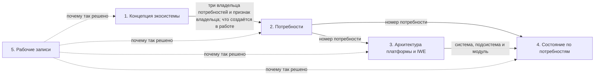

# [ECO.MAP.003] Пять документов экосистемы

**Для кого:** все, кто читает или правит описания экосистемы, платформы и ИИ-среды: участники команды, авторы, их ИИ-агенты. **На какой вопрос отвечает:** какой документ о чём, где он лежит и как документы связаны. **Чего здесь не искать:** самого содержания — оно в пяти документах по ссылкам ниже.

<!-- fold -->

## Зачем набор

Одно и то же нельзя описывать в нескольких местах: одно место устаревает, другое нет, и читатель не знает, чему верить. Поэтому вопросы «зачем», «чего хотят люди», «как устроено», «что уже работает» и «почему так решили» разведены по пяти документам. У каждого документа один вопрос и свой читатель. Каждое утверждение записано в одном документе, остальные на него ссылаются.

<!-- /fold -->

<!-- fold -->

## Пять документов

| № | Документ | На какой вопрос отвечает | Для кого | Что внутри | Где лежит | Как часто меняется |
|---|---|---|---|---|---|---|
| 1 | Концепция экосистемы | зачем всё это и что развивается | все, в том числе внешние читатели и их ИИ | главная идея — созидание систем человеком с помощью системного мышления и своей ИИ-среды; три развивающиеся системы (человек, ИИ-среда, железный человек); культура сообщества и Библиотека методов; три владельца потребностей и признак владельца; что создаётся в работе и чем это меряется; три состояния ИИ-среды; шесть уровней изменения; самоподдерживающееся развитие и переходы между работой и развитием; пять измерений развития; кто создаёт экосистему; чего концепция не утверждает | [пак экосистемы, ECO.CONCEPT.001](https://github.com/MimEcoSys/PACK-ecosystem/blob/main/pack/ecosystem/02-domain-entities/ECO.CONCEPT.001-ecosystem-concept.md) | редко: при изменении замысла |
| 2 | Потребности | чьи потребности и какие обещания платформы и ИИ-среды их обслуживают | продуктолог, архитектор, тестировщик, выпускающий | 103 потребности в 12 блоках, от знакомства без регистрации до внешней работы с приёмкой; по каждой потребности: у кого она, чья она (железный человек, человек или создатели), что человек получает, через какие каналы работает, где будут размещены средства; порядок и обещание для внешней работы с приёмкой; функции, которых не хватает, с привязкой к потребностям; по каждой потребности — критерий успеха (что меряем, цель, откуда берём, кто отвечает) и обещания, которые её покрывают | [пак платформы, DP.MAP.005](https://github.com/MimEcoSys/PACK-digital-platform/blob/main/pack/digital-platform/07-map/DP.MAP.005-mcp-scenarios.md) | при новой потребности или новом обещании |
| 3 | Архитектура платформы и IWE | как устроены платформа и IWE; это стартовая архитектура, дальше её ведёт команда разработки запросами на слияние | команда разработки, архитектор | границы между человеком, ИИ-средой, платформой и окружением; функциональные подсистемы платформы и IWE; слои платформы по пути запроса; модули — конкретные программы и службы; размещение; MCP; данные; ключевые механизмы и сквозные пути; соответствия «функциональная подсистема → модуль» и «потребность → функциональная подсистема → модуль»; архитектурные характеристики и принципы; правила поведения ИИ; открытые вопросы; термины; три вида IWE в учёте (по шаблону, у вендора, у разработчика); системы, их релизы и Выпускающие; переход с mcp.aisystant.com на четыре целевых MCP | [пак платформы, DP.ARCH.001](https://github.com/MimEcoSys/PACK-digital-platform/blob/main/pack/digital-platform/02-domain-entities/DP.ARCH.001-platform-architecture.md) | при изменении устройства |
| 4 | Состояние по потребностям | что из этого уже работает, что строится, что в плане и что проверить | выпускающий и тестировщики; из него строится табло выпуска | по каждой потребности — одна строка (подробно ниже); средства по потребностям; все видимые изменения по потребностям, у каждого постоянный код | [репозиторий развития экосистемы, Goals-State](https://github.com/aisystant/DS-ecosystem-development/blob/main/C.IT-Platform/C2.IT-Platform/C2.3.Operations/Goals-State/state-by-goals.md) | постоянно: при каждом выпуске и изменении работ |
| 5 | Рабочие записи | почему так решено | автор и агенты; команде читать не нужно | решения и их основания; расхождения между прежними описаниями; сведения о состоянии, вынесенные из архитектуры; разметка «чья потребность» с пояснениями; черновики, из которых собраны документы 2–4; откуда взято каждое утверждение концепции | [репозиторий развития экосистемы, Goals-State/working-records](https://github.com/aisystant/DS-ecosystem-development/tree/main/C.IT-Platform/C2.IT-Platform/C2.3.Operations/Goals-State/working-records) | по ходу работы; в другие документы не копируются |

Документы о деле жизни основателя (миссия, устав) к набору не относятся: они остаются авторскими, концепция на них ссылается.

<!-- /fold -->

<!-- fold -->

## Документ 4 подробнее

**Что в строке.** Одна строка — одна потребность:

- номер потребности из документа 2 (текст потребности не копируется, он ведётся в документе 2);
- состояние средств потребности: Р работает, Ч работает частично, Н есть, не проверено, З есть, не работает, О средства нет; число рядом показывает, сколько средств в таком состоянии;
- стадии работ по потребности — четыре колонки с числами: «Сделано», «В работе», «В плане», «Отложено»; число показывает, сколько изменений потребности на этой стадии (буквы обозначают только состояние средств);
- инструменты MCP, которые обслуживают потребность сейчас;
- выпуск, на котором потребность проверена.

**Цепочка учёта.** Потребность → обещание платформы и IWE → изменение → релиз. Потребность — чего хочет роль в ситуации использования, ведётся в документе 2. Обещание платформы и IWE — обещанный исход, кому обещано, как проверить и кто его держит, ведётся в разделе обещаний пака платформы. Изменение — описание разницы в поведении системы или в содержании её документов между двумя версиями, которую замечает человек; вид — фича, улучшение или исправление; связь изменения с обещанием ставится только подтверждённая; ведётся строкой документа 4. Системы — по одному перечню (редакция 3 учёта, РП-611 Ф21, §2): IWE по шаблону, IWE у вендора, IWE у разработчика; бот МИМ; MCP, открытые и по подписке, по регионам; стенд iwe.system-school.ru; сайты платформы; прочие программы платформы. Шаблон IWE хранит документы системы «IWE по шаблону» и сам системой не считается. Релиз — проверенная и выданная людям версия документов системы; у каждой системы свои релизы и свой Выпускающий. Одно изменение может служить нескольким потребностям, одна потребность может требовать нескольких изменений. Сборка (кандидат в релиз) и запрос на слияние в цепочку не входят. В документе 4 учитываются только изменения трёх видов; прочие записи (материалы, метрики, проверки) разбираются отдельно (РП-611 Ф26).

**Коды изменений.** У каждого изменения постоянный код вида «Ц1-07»: номер потребности из документа 2 и порядковый номер изменения по этой потребности. Код не меняется между срезами, поэтому видно, какая строка изменилась. Какой работой выполняется изменение, показывает таблица «код → РП» в рабочих записях ([result-codes.md](https://github.com/aisystant/DS-ecosystem-development/blob/main/C.IT-Platform/C2.IT-Platform/C2.3.Operations/Goals-State/working-records/result-codes.md)); в самом документе 4 номеров РП нет.

**Кто ведёт и как часто.** Документ ведут руками: тестировщик заполняет «Проверено на выпуске» после проверки выпуска, выпускающий ставит дату среза при каждом выпуске. Дата среза одна на весь документ. Сборка документа из карточек работ появится вместе с табло выпуска; до тех пор он не пересобирается автоматически. Из этого документа строится [табло выпуска](https://github.com/MimEcoSys/DS-iwe-releases): строка табло — изменение с кодом Ц, при расхождении текста прав этот документ. Когда заработает сборщик табло, колонка «Проверено на выпуске» станет производной от табло и ручное ведение снимется.

**Пределы.** Стадии взяты из описаний работ, а не из кода. «Средство есть» означает, что есть код; работает ли он, показывает только проверка на выпуске.

<!-- /fold -->

<!-- fold -->

## Куда что относится

| Если вопрос | Документ |
|---|---|
| «Зачем?» | 1. Концепция экосистемы |
| «Кому и что?» | 2. Потребности |
| «Чем и как?» | 3. Архитектура платформы и IWE |
| «Уже есть?» | 4. Состояние по потребностям |
| «Почему так решили?» | 5. Рабочие записи |

<!-- /fold -->

<!-- fold -->

## Как документы связаны

- **1 → 2.** Концепция задаёт трёх владельцев потребностей (признак — кто делает результат) и что создаётся в работе; документ 2 размечает по ним каждую потребность.
- **2 → 3.** Номер потребности из документа 2; документ 3 связывает его с подсистемой и модулем (цепочка «потребность → функциональная подсистема → модуль»).
- **2, 3 → 4.** Номер потребности — из документа 2; система и подсистема или модуль — из документа 3; документ 4 ставит по ним состояние, стадии работ и выпуск, на котором проверено.
- **5 → все.** Рабочие записи объясняют, почему так решено: решения, расхождения, история.

<!-- /fold -->

<!-- fold -->

## Правила набора

- Номера потребностей ведёт только документ 2; документы 3 и 4 держат номер потребности, текст потребности не копируют.
- Состояние средств по потребностям (что работает, что частично, чего нет) и стадии работ по потребностям (сделано, в работе, в плане, отложено) ведёт только документ 4; документ 3 на него ссылается. Пометки об устройстве в документах 2 и 3 («модуль не назначен», «функции, которых не хватает») состоянием средств не являются и остаются там.
- Пак не получает содержание из документа 4; документ 4 ссылается на номера потребностей документа 2 и на подсистемы и модули документа 3.
- Каждое утверждение записано в одном документе, другие ссылаются на него, указывая номер и название раздела.
- Документы 1–3 правятся только после согласия автора; документы 4 и 5 ведут исполнители.
- Каждый из документов 1–3 начинается блоком «Пять документов и как они связаны»: какое место он занимает в цепочке, что получает и что передаёт.

<!-- /fold -->
