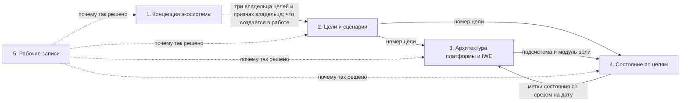

# [ECO.MAP.003] Пять документов экосистемы

**Для кого:** все, кто читает или правит описания экосистемы, платформы и ИИ-среды: участники команды, авторы, их ИИ-агенты. **На какой вопрос отвечает:** какой документ о чём, где он лежит и как документы связаны. **Чего здесь не искать:** самого содержания — оно в пяти документах по ссылкам ниже.

## Зачем набор

Одно и то же нельзя описывать в нескольких местах: одно место устаревает, другое нет, и читатель не знает, чему верить. Поэтому вопросы «зачем», «чего хотят люди», «как устроено», «что уже работает» и «почему так решили» разведены по пяти документам. У каждого документа один вопрос и свой читатель. Каждое утверждение записано в одном документе, остальные на него ссылаются.

## Пять документов

| № | Документ | На какой вопрос отвечает | Для кого | Что внутри | Где лежит | Как часто меняется |
|---|---|---|---|---|---|---|
| 1 | Концепция экосистемы | зачем всё это и что развивается | все, в том числе внешние читатели и их ИИ | главная идея — созидание систем человеком с помощью системного мышления и своей ИИ-среды; три развивающиеся системы (человек, ИИ-среда, железный человек); культура сообщества и Библиотека методов; три владельца целей и признак владельца; что создаётся в работе и чем это меряется; три состояния ИИ-среды; шесть уровней изменения; самоподдерживающееся развитие и переходы между работой и развитием; пять измерений развития; кто создаёт экосистему; чего концепция не утверждает | [пак экосистемы, ECO.CONCEPT.001](https://github.com/MimEcoSys/PACK-ecosystem/blob/main/pack/ecosystem/02-domain-entities/ECO.CONCEPT.001-ecosystem-concept.md) | редко: при изменении замысла |
| 2 | Цели и сценарии | чьи цели и какие обещания платформы и ИИ-среды их обслуживают | продуктолог, архитектор, тестировщик, выпускающий | 103 цели в 12 блоках, от знакомства без регистрации до внешней работы с приёмкой; по каждой цели: кто её ставит, чья она (железный человек, человек или создатели), что человек получает, через какие каналы работает, где будут размещены средства; сценарий и обещание для внешней работы с приёмкой; функции, которых не хватает, с привязкой к целям | [пак платформы, DP.MAP.005](https://github.com/MimEcoSys/PACK-digital-platform/blob/main/pack/digital-platform/07-map/DP.MAP.005-mcp-scenarios.md) | при новой цели или новом обещании |
| 3 | Архитектура платформы и IWE | как устроено | архитектор, разработчики | границы между человеком, ИИ-средой, платформой и окружением; функциональные подсистемы платформы и IWE; слои платформы по пути запроса; модули — конкретные программы и службы; размещение; MCP; данные; ключевые механизмы и сквозные пути; соответствия «подсистема → модуль» и «цель → подсистема → модуль»; архитектурные характеристики и принципы; правила поведения ИИ; открытые вопросы; термины | [пак платформы, DP.ARCH.001](https://github.com/MimEcoSys/PACK-digital-platform/blob/main/pack/digital-platform/02-domain-entities/DP.ARCH.001-platform-architecture.md) | при изменении устройства |
| 4 | Состояние по целям | что из этого уже работает, что строится, что в плане и что проверить | тестировщик, выпускающий, архитектор | по каждой цели — одна строка (подробно ниже); средства по целям; все видимые результаты по целям | [репозиторий развития экосистемы, Goals-State](https://github.com/aisystant/DS-ecosystem-development/blob/main/C.IT-Platform/C2.IT-Platform/C2.3.Operations/Goals-State/state-by-goals.md) | постоянно: при каждом выпуске и изменении работ |
| 5 | Рабочие записи | почему так решено | авторы и агенты | решения и их основания; расхождения между прежними описаниями; сведения о состоянии, вынесенные из архитектуры; разметка «чья цель» с пояснениями; черновики, из которых собраны документы 2–4; откуда взято каждое утверждение концепции | [репозиторий развития экосистемы, Goals-State/working-records](https://github.com/aisystant/DS-ecosystem-development/tree/main/C.IT-Platform/C2.IT-Platform/C2.3.Operations/Goals-State/working-records) | по ходу работы; в другие документы не копируются |

Документы о деле жизни основателя (миссия, устав) к набору не относятся: они остаются авторскими, концепция на них ссылается.

## Документ 4 подробнее

**Что в строке.** Одна строка — одна цель:

- номер цели из документа 2 (текст цели не копируется, он ведётся в документе 2);
- состояние средств цели: Р работает, Ч работает частично, Н есть, не проверено, З есть, не работает, О средства нет; число рядом показывает, сколько средств в таком состоянии;
- стадии работ по цели: С сделано, Р в работе, П план, О отложено; число показывает, сколько результатов на этой стадии;
- инструменты MCP, которые обслуживают цель сейчас;
- выпуск, на котором цель проверена.

Для схем документа 3 состояние сводится к четырём меткам: есть, строится, задумано, не установлено.

**Кто ведёт и как часто.** Документ ведут руками: тестировщик заполняет «Проверено на выпуске» после проверки выпуска, выпускающий ставит дату среза при каждом выпуске. Дата среза одна на весь документ. Сборка документа из карточек работ появится вместе с табло релиза; до тех пор он не пересобирается автоматически.

**Пределы.** Стадии взяты из описаний работ, а не из кода. «Средство есть» означает, что есть код; работает ли он, показывает только проверка на выпуске.

## Куда что относится

| Если вопрос | Документ |
|---|---|
| «Зачем?» | 1. Концепция экосистемы |
| «Кому и что?» | 2. Цели и сценарии |
| «Чем и как?» | 3. Архитектура платформы и IWE |
| «Уже есть?» | 4. Состояние по целям |
| «Почему так решили?» | 5. Рабочие записи |

## Как документы связаны

- **1 → 2.** Концепция задаёт трёх владельцев целей (признак — кто делает результат) и что создаётся в работе; документ 2 размечает по ним каждую цель.
- **2 → 3.** Номер цели из документа 2; документ 3 связывает его с подсистемой и модулем (цепочка «цель → подсистема → модуль»).
- **2, 3 → 4.** Номер цели и модуль; документ 4 ставит по ним состояние, стадии работ и выпуск, на котором проверено.
- **4 → 3.** Метки состояния попадают на схемы документа 3 как срез с датой.
- **5 → все.** Рабочие записи объясняют, почему так решено: решения, расхождения, история.

## Правила набора

- Номера целей ведёт только документ 2; документы 3 и 4 держат номер цели, текст цели не копируют.
- Метки состояния правятся только в документе 4; в документе 3 они повторяются как срез с датой.
- Каждое утверждение записано в одном документе, другие ссылаются на него, указывая номер и название раздела.
- Документы 1–3 правятся только после согласия автора; документы 4 и 5 ведут исполнители.
- Каждый из документов 1–3 начинается блоком «Пять документов и как они связаны»: какое место он занимает в цепочке, что получает и что передаёт.
